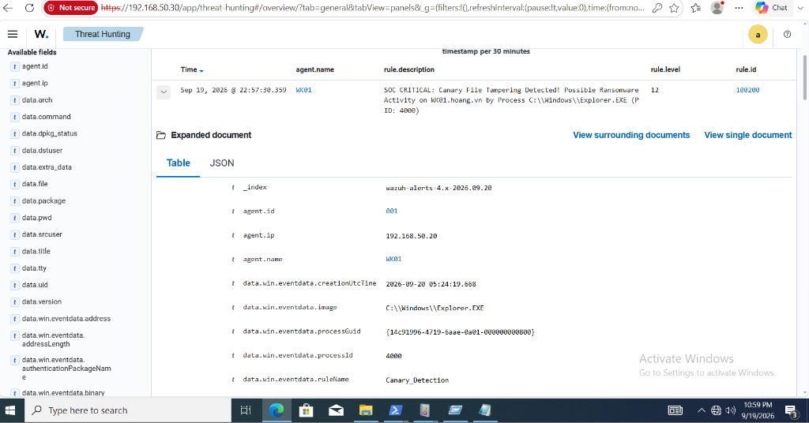

# Canary file detection and process triage

I used a disposable TXT file to generate Sysmon Event 11, trigger a Wazuh alert and collect process evidence with a PowerShell handler.

The maintained [scenario, configuration and tests](https://github.com/LeeHoang26/ad-threat-detection-and-response-lab/tree/main/ransomware-memory-triage) are in the consolidated lab. This repository keeps the standalone source and recorded evidence.

## Setup

The recorded lab used Wazuh 4.8 on Ubuntu 22.04, Windows Security/Sysmon telemetry and an isolated VMware network. DC01 used 192.168.50.10, WK01 192.168.50.20, the Manager 192.168.50.30 and the Kali test client 192.168.50.40.

## Detection and response

- Rule 100200 checks the standalone canary filename condition.
- The maintained scenario requires the alert, ProcessGuid, image, event time and a matching process-create record before opted-in actions.
- A canary write is a file-activity signal; it does not establish ransomware.

Current response settings and failure-path tests are documented in the maintained scenario above. The current Windows snippets use local scope for the agent that generated the alert.

## Evidence

The screenshots show rule 100200, process fields and artifacts for PIDs 6140 and 2584, including a process dump listed at about 258 MB. No encryption-key recovery is demonstrated.

## Related lab

[Wazuh Detection Quality and Regression Lab](https://github.com/LeeHoang26/wazuh-detection-quality-lab) contains the offline corpus and reports. Its precision and recall describe that corpus.

Le Duc Hoang
